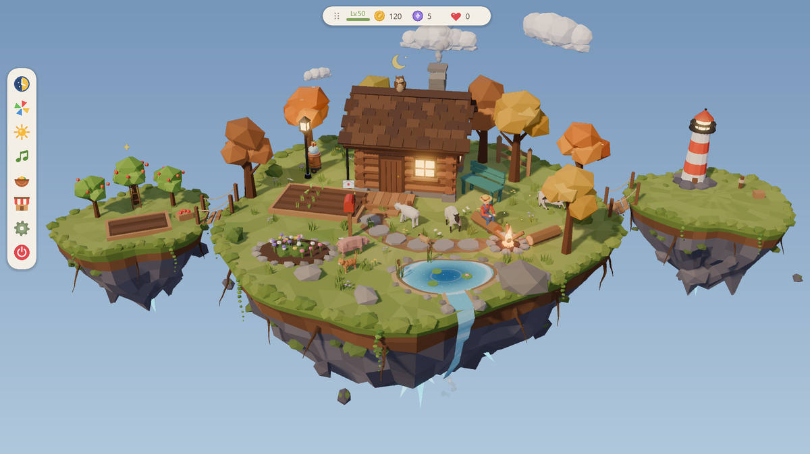
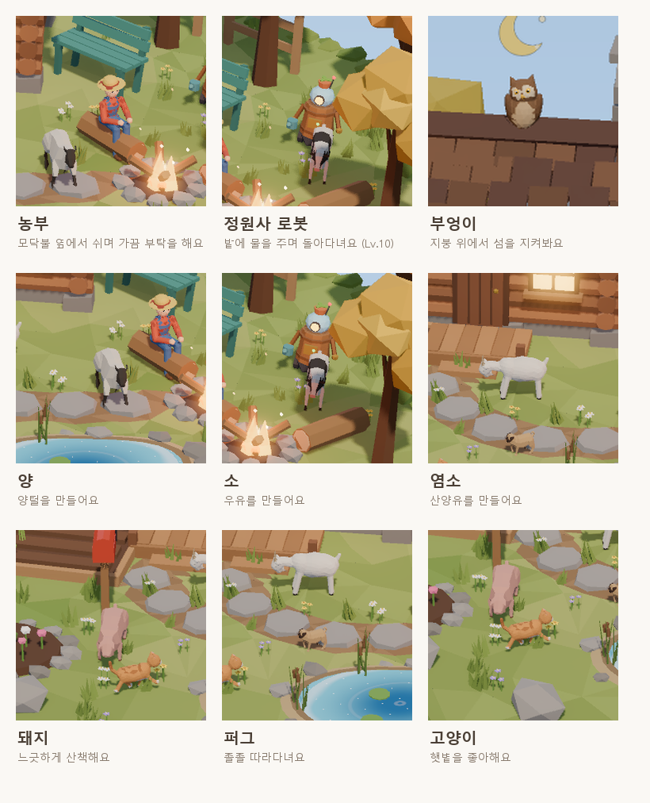
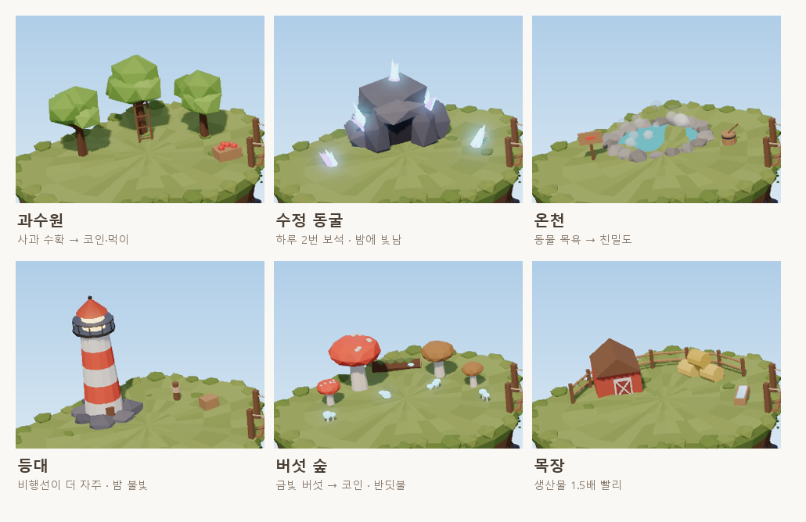
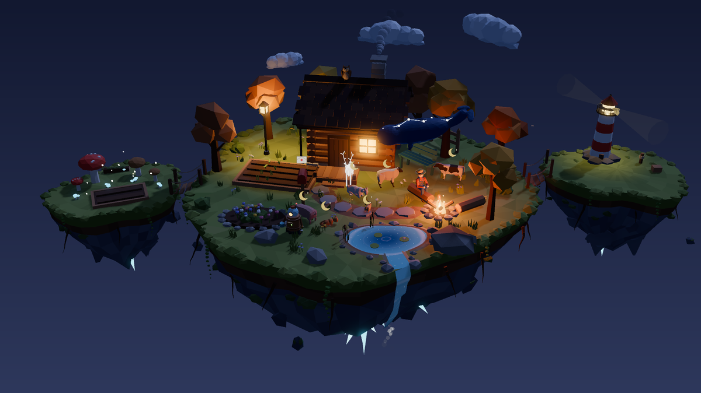
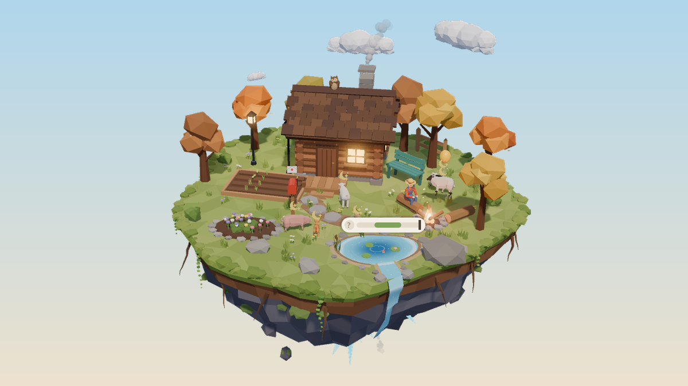
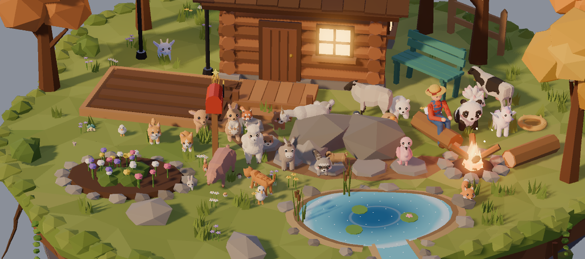
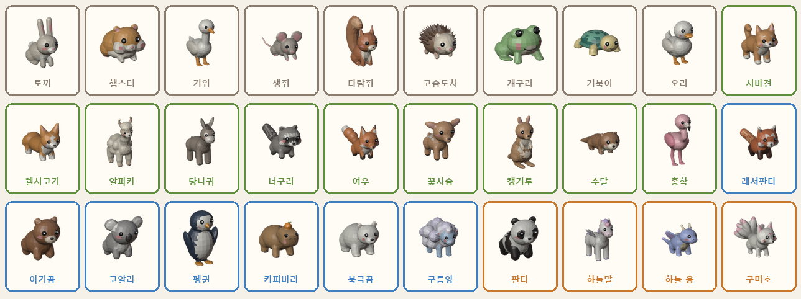
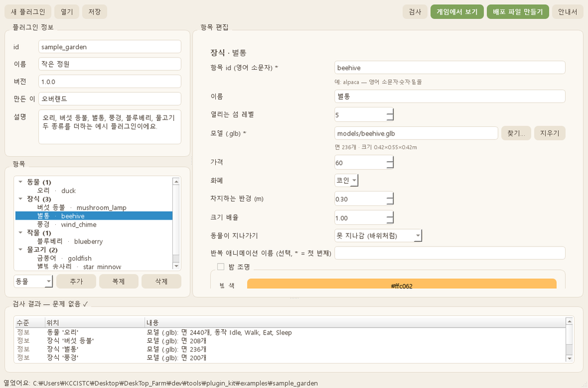
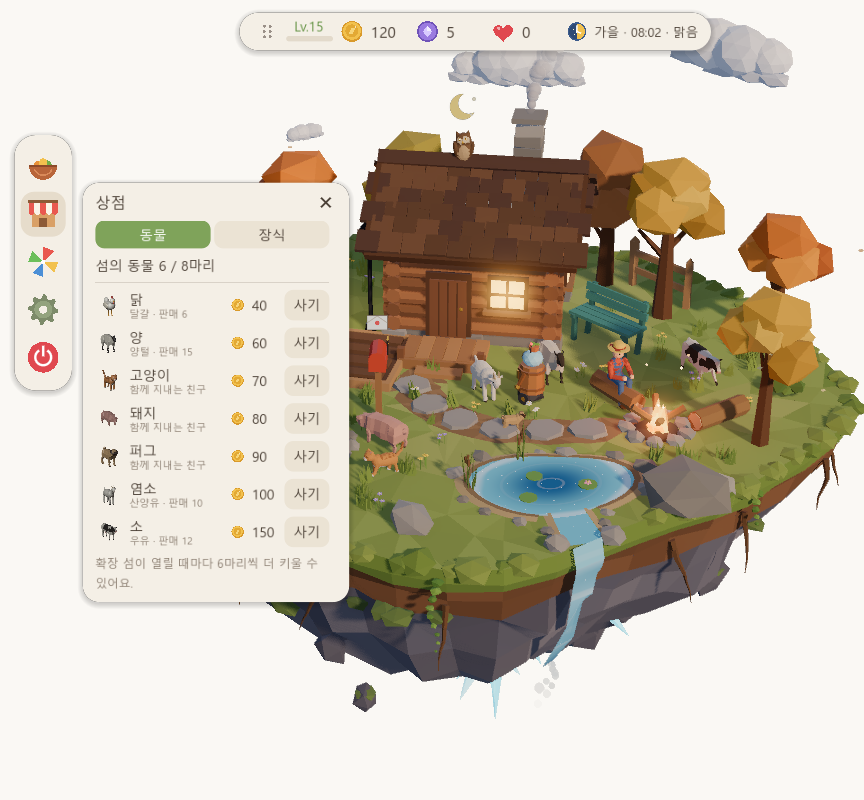

# 오버랜드: 하늘 농장

**Overland: Sky Farm** — 바탕화면 위에 떠 있는 작은 하늘섬 농장

작업하는 동안 바탕화면 한쪽에 작은 하늘섬을 띄워 두고, 밭을 가꾸고 동물을 돌보는 Windows용 데스크톱 게임이에요.
창은 투명해서 섬만 보이고, 섬 바깥을 클릭하면 뒤에 있는 바탕화면이나 다른 창이 그대로 눌려요.

> 이름의 뜻: **오버랜드(Overland)** — "땅(land) 위를 넘어(over)" 떠 있는 섬

---

## 다운로드와 실행

1. 오른쪽 **Releases**에서 `Overland-1.2.0-windows-x64.zip`을 받아 압축을 풀어요.
2. `Overland` 폴더 안의 **`Overland.exe`**를 실행해요. 설치는 필요 없어요.

| Releases 파일 | 내용 |
|---|---|
| `Overland-1.2.0-windows-x64.zip` | 게임 본체 |
| `play_pack-1.0.2.dlc` | 공식 DLC **놀이팩** (선택) — 아래 [확장: DLC와 플러그인](#확장-dlc와-플러그인) 참고 |
| `cozy_ranch-1.2.0.dlc` | 공식 DLC **포근 목장** (선택) — 동물 30종을 알·아기부터 키우기 |
| `friend_visit-1.0.0.dlc` | 공식 DLC **소꿉친구의 방문** (선택) — 농부의 친구가 열기구를 타고 놀러 와요 |
| `clockwork_village-1.0.0.dlc` | 공식 DLC **태엽 공방마을** (선택 · 섬 테마) — 섬 전체를 스팀펑크 공방 도시로 |
| `Overland-PluginKit-1.2.0-windows-x64.zip` | 플러그인을 직접 만드는 도구 (선택) |

- 필요한 환경: **Windows 10/11 64비트**, DirectX 12를 지원하는 그래픽카드
- `data_DeskTopFarm_windows_x86_64` 폴더는 항상 `Overland.exe` 옆에 같이 두세요.
- 게임은 하나만 실행돼요. 이미 켜져 있으면 숨어 있던 섬이 다시 나타나요.
- 예전 버전에서 하던 진행 상황은 새 버전에서 그대로 이어져요. 새 폴더에 풀어도 돼요.
- 처음 실행할 때 Windows SmartScreen 경고가 뜨면 **추가 정보 → 실행**을 눌러 주세요. (코드 서명이 없는 개인 제작 앱이라서 떠요)

---

## 주요 기능

| | |
|---|---|
| 🌱 **밭** | 밀·당근·호박을 심고 수확해요. 게임을 꺼 둔 동안에도 자라요. |
| 🐑 **동물** | 먹이 주기, 쓰다듬기, 이름 짓기, 친밀도, 생산물(우유·양털·달걀) |
| 🏡 **꾸미기** | 상점에서 장식을 사서 원하는 곳에 놓고 돌려 보세요. 처음부터 있던 나무·바위·벤치·우체통도 옮기거나 창고에 넣을 수 있어요. |
| ⭐ **섬 레벨 1~50** | 레벨이 오를 때마다 새 기능이 하나씩 열려요. |
| 🌙 **낮과 밤·계절·날씨** | 위쪽 **시계**에 계절·시각·날씨가 늘 보여요. PC 시각 또는 게임 시간, 사계절, 맑음·비·눈 — 실제 날씨와 연동할 수도 있어요 (설정 → 시간·날씨에서 도시 입력). |
| ⏱️ **집중 타이머** | 위쪽 시계를 누르면 시작해요. 집중하는 동안 작물이 1.5배 빨리 자라요. |
| 💤 **자리 비움 감지** | 컴퓨터를 한동안 안 쓰면 동물들이 낮잠을 자고, 돌아오면 반겨 줘요. |
| 📷 **사진** | 섬을 투명 배경 PNG로 저장해요. |
| 🖥️ **창 모드** | 일반 / 항상 위 / 바탕화면 고정, 섬 크기 50~180% 슬라이드바, 저전력 모드 |
| 🪟 **미니 섬** | 다른 창에 섬이 절반 넘게 가려지면 오른쪽 아래에 작은 섬이 반투명으로 떠요. 구경만 하고 클릭은 뒤 창으로 — 가림이 풀리면 원래 섬으로 돌아와요 |
| 📮 **편지** | 우체통에 편지가 오면 HUD에 편지 아이콘이 떠요. 선물이 들어 있기도 해요. |
| 👋 **다녀오셨어요** | 30분 넘게 자리를 비웠다 오거나 게임을 다시 켜면, 그동안 다 자란 작물·배고픈 동물 등을 한눈에 보여 줘요. |
| 💾 **저장** | 30초마다 자동 저장 + 하루 1번 자동 백업. 설정 → 정보에서 백업으로 되돌릴 수 있어요. |
| 🧩 **확장** | 공식 DLC(놀이팩·포근 목장·소꿉친구의 방문·태엽 공방마을)와 누구나 만들 수 있는 플러그인(동물·장식·작물·물고기). 게임 버전과 맞지 않는 확장은 켜지지 않고 "호환 안 됨"으로 알려 줘요. |
| 🎨 **섬 테마** | 테마 DLC를 넣으면 섬 전체의 모양·색·이름·그림이 바뀌어요 (설정 → 확장 → 테마). 게임 규칙과 진행은 그대로라 언제든 되돌릴 수 있어요. |
| 🎮 **방해하지 않기** | 게임·영상이 전체 화면이면 섬이 잠시 숨어요. 트레이 아이콘, Windows 시작 시 자동 실행 |

---

## 섬의 주민들

- **농부** — 하루를 살아요. 아침에 집에서 나와 기지개를 켜고, 낮엔 밭·연못·동물을 둘러보고(점심쯤엔 확장 섬도), 저녁엔 모닥불 통나무에 앉아 불을 쬐고, 밤엔 집에 들어가 자요. 가끔 머리 위에 "!"를 띄우고 부탁을 하는데, 들어주면 보상을 받아요 (부탁이 있으면 그 자리에서 기다려요).
- **정원사 로봇** (Lv.10) — 섬을 돌아다니며 밭에 물을 줘서 작물을 빨리 자라게 해요. 밤에는 머리 위에 Zzz를 띄우고 쉬어요.
- **동물들** — 양·소·염소는 생산물을 만들고, 상점에서 닭을, 하늘을 떠도는 **비행선 상인**(Lv.20)에게서 말·라마를 데려올 수 있어요.
- 동물들은 다리를 건너 다른 섬으로 놀러 가기도 해요. 나무·집 사이 좁은 틈에 갇히면 1분 안에 알아서 빠져나와요.

---

## 확장 섬과 테마

Lv.25에 **왼쪽 섬**, Lv.50에 **오른쪽 섬**이 열려요. 섬이 열릴 때 6가지 테마 중 하나를 골라 꾸며요. (같은 테마는 한 번만)

| 테마 | 특징 |
|---|---|
| 🍎 과수원 | 사과가 익으면 수확 → 코인과 동물 먹이 |
| 💎 수정 동굴 | 하루 2번 보석, 밤에 은은하게 빛남 |
| ♨️ 온천 | 동물이 목욕하며 친밀도가 올라감 |
| 🗼 등대 | 밤에 불빛이 돌고, 비행선 상인이 더 자주 찾아옴 |
| 🍄 버섯 숲 | 금빛 버섯 수확 → 코인, 밤엔 반딧불 |
| 🐴 목장 | 그 섬에 있는 동물의 생산물이 1.5배 빨라짐 |

---

## 밤 풍경

밤이 되면 동물들이 잠들고 불빛이 켜져요. 은은하게 빛나는 **영혼 사슴**이 거닐고, 별똥별이 지나가고,
Lv.42부터는 **별자리 고래**가 섬 위를 천천히 헤엄쳐요.

---

## 확장: DLC와 플러그인

### 놀이팩 (공식 DLC)

- 🎣 **연못 낚시** — 연못을 누르면 찌를 던져요. 찌가 쑥 들어가면 바로 누르고, 막대의 초록 칸에서 한 번 더 누르면 잡아요. 시간·계절·날씨마다 나오는 물고기가 달라요. 잡은 물고기는 **도감·업적** 창의 **물고기** 탭에 모여요 (11종 + 플러그인 물고기).
- 🤲 **동물 집어 옮기기** — 동물을 꾹 눌러 끌면 들어 올려요. 원하는 곳에 내려놓아 보세요.
- 🌀 **섬 흔들기** — 손잡이로 창을 잡고 빠르게 흔들면 동물들이 휘청거리고, 세게 계속 흔들면 가장자리 동물이 떨어져요.
- 🎈 **떨어진 동물** — 섬 밖으로 떨어진 동물은 게임 시간으로 하루 뒤 풍선을 타고 돌아와요.

### 포근 목장 (공식 DLC)

- 🥚 **알 뽑기** — 상점의 **포근 목장** 탭에서 농장·숲·물가 알(80코인), Lv.25부터 하늘 알(보석 6)을 사요. 무엇이 나올지는 깨 봐야 알아요!
  - 희귀도 일반 60% · 고급 28% · 희귀 10% · 전설 2% (상점에서 **확률 보기**)
  - **천장**: 10개 안에 희귀 이상 1마리는 꼭 나와요. 아주 드물게(1%) 눈꽃·황금 색 변이도 있어요.
- 🪺 **둥지** — 산 알은 섬의 둥지에서 부화해요. 알을 쓰다듬으면 조금 빨리 깨요. 부화 칸은 2개(Lv.20에 3개, Lv.35에 4개).
- 🍼 **아기 키우기** — 아기 → 어린이 → 어른. 하루에 한 번 배고플 때 먹이를 먹으면 다음 날 한 단계 자라요. 원하는 동물은 상점 → 포근 목장 → **아기**에서 바로 살 수도 있어요 (전설은 알에서만).
- 💌 **분양 보내기** — 다 키운 동물을 새 가족에게 보내면 코인을 받고, 다음 날 감사 편지가 와요. 자랄수록·친할수록 분양가가 올라가요. 상점·비행선에서 산 동물(닭·말·라마 등)도 분양할 수 있어요 (산 값의 절반 + 친밀도 보너스).
- 📖 **도감·헛간·별가루** — 30종 도감(도감·업적 창의 포근 목장 탭)을 채워 보세요. 섬이 가득 차면 **헛간**(12칸)에서 쉬고, 이미 만난 동물이 또 나오면 별가루가 생겨 원하는 알로 바꿀 수 있어요.
- 🤖 **자동 업무** — Lv.10 정원사 로봇이 배고픈 동물에게 먹이를 주고, 생산물을 줍고, 다 자란 작물을 거두고, 빈 칸에 씨앗을 심어요. 켜 두면 **밤에도 쉬지 않아요**. 손으로 할 때보다 코인 50% · 경험치 5% · 친밀도 절반이고, 씨앗과 먹이는 직접 사 주세요. 오늘 로봇이 한 일도 볼 수 있어요.

- 🐑 **처음 동물도 분양·헛간** (1.2.0) — 닭·양·고양이·돼지·퍼그·염소·소도 분양하거나 헛간에 보낼 수 있어요. 농부의 부탁(생산물)에 필요한 닭·양·염소·소는 종류마다 마지막 1마리는 섬에 남겨요.

### 소꿉친구의 방문 (공식 DLC)

- 🎈 농부의 소꿉친구가 **열기구**를 타고 놀러 와요 — 일주일에 한 번(전날 편지), 가끔 깜짝 방문, 레벨 10·20·30·40·50 다음 날 아침 축하 방문
- 🎁 처음 말을 걸면 **선물** (코인·보석·씨앗·먹이·고향 기념품 중 하나)
- 🧺 **보따리 장터** — 매번 무작위 4칸, 상점보다 15% 싸요. 가끔 **친구에게서만 데려올 수 있는 동물** (페넥여우·쿼카·피그미 하마·나무늘보·친칠라)
- 💰 머무는 날엔 수확·생산물 코인 +30% · (포근 목장) 친구에게 분양 +30%
- 🔥 저녁엔 농부와 모닥불 앞에 나란히 앉아 이야기하고, 다음 날 아침 떠나요

### 태엽 공방마을 (공식 DLC · 섬 테마)

- ⚙️ 섬을 통째로 **스팀펑크 공방 도시**로 — 뒤쪽엔 탑·첨탑·굴뚝 성벽, 집 뒤엔 천천히 도는 거대한 톱니 고리, 시계탑 공방(바늘이 게임 시각을 가리켜요)
- 🐑 **태엽 동물 39종** — 기본 동물 + 포근 목장 30종 모두 강철·구리 몸에 등 열쇠가 빙글빙글 · 농부는 톱햇·고글의 기관사로
- 🏝️ 확장 섬·다리·섬 테마 6종도 태엽 버전 (유리 온실 · 보석 광산 · 증기탕 · 신호탑 · 버섯 배양실 · 기계 차고)
- 🌙 해 질 녘엔 가스등이 하나씩 켜지고, 겨울엔 금속에 서리와 고드름 · 회중시계 HUD · 양피지·놋쇠 색 UI
- 💨 **증기 축제** — 수확·먹이·생산물로 게이지를 채우면 1분 동안 증기 불꽃 + 수확·생산물 코인 +20%
- 처음 넣으면 "태엽 공방마을로 바꿀까요?"가 떠요. 나중엔 **설정 → 확장 → 테마**에서 언제든 농장 ↔ 태엽 공방마을

### 플러그인 (누구나 만들기)

- 플러그인은 **모델·그림·소리·설정만** 담은 묶음이라 코드가 실행되지 않아 안전해요.
- **오버랜드 플러그인 킷**으로 코딩 없이 만들고, 게임에서 바로 확인하고, zip 한 파일로 묶어 나눌 수 있어요. 자세한 방법은 킷 안의 `docs/플러그인_만들기.html`을 봐 주세요.
- 플러그인 동물에 **알 종류·희귀도**를 정해 두면, 포근 목장이 있을 때 그 알에서도 아기로 태어나요.
- 동물·장식마다 **테마별 모델**(예: 태엽 공방마을일 때 모습)을 넣을 수 있어요.
- 킷이 필요한 게임 버전을 플러그인에 자동으로 적어 줘요. 게임이 더 옛 버전이면 "호환 안 됨"으로 알려 줘요.

### 설치·끄기

1. 게임에서 **설정 → 확장 → 확장 폴더 열기**
2. 공식 DLC(`.dlc`) 또는 플러그인 `.zip`을 그 폴더에 넣고 **다시 불러오기** (예전 버전 파일은 지워 주세요)
3. 같은 화면에서 확장마다 켬/끔을 바꿀 수 있어요. 플러그인을 빼도 진행 상황은 그대로 남아요.

> 공식 DLC는 제작자 서명이 맞는 파일만 열려요. 놀이팩 1.0.2 는 게임 **1.1.1 이상**, 포근 목장 1.2.0 · 소꿉친구의 방문 1.0.0 · 태엽 공방마을 1.0.0 은 게임 **1.2.0 이상**이 필요해요.

---

## 레벨 해금표

| 레벨 | 열리는 것 |
|---|---|
| 1 | 밀·당근, 기본 동물과 장식 |
| 3 | 닭, 동물 생산물 |
| 6 | 호박 씨앗, 농부의 부탁 |
| 10 | 정원사 로봇 |
| 15 | 소·염소·돼지, 장식 추가 |
| 20 | 비행선 상인 |
| 25 | 왼쪽 섬 (테마 고르기, 동물 +6) |
| 30 | 두 번째 밭 |
| 42 | 별자리 고래 |
| 50 | 오른쪽 섬 (테마 고르기, 동물 +6) |

---

## 조작 방법

- **창 옮기기**: 위쪽 HUD 왼쪽의 점무늬 손잡이(⠿)를 끌어요.
- **왼쪽 메뉴**: 먹이·밭(씨앗·먹이 사기) · 상점(동물·장식) · 꾸미기 · (포근 목장) · 설정(화면·시간·날씨·소리·확장(테마)·정보) · 종료
- **위쪽 시계**: 누르면 집중 타이머 · **코인·보석·하트**: 도감·업적 (포근 목장·물고기 도감 포함) · **Lv 배지**: 해금표
- **H 키**: UI 숨기기/보이기 · **P 키**: 사진 찍기
- **트레이 아이콘**: 왼쪽 클릭 = 섬 숨기기/보이기 (미니 섬일 때는 바로 원래 섬으로), 오른쪽 클릭 = 설정 열기
- **놀이팩**: 동물을 꾹 눌러 끌기 = 들어 옮기기 · 연못 누르기 = 낚시 (Esc = 그만두기)
- **포근 목장**: 메뉴의 알 = 둥지·헛간·자동 업무 · 둥지·로봇 누르기 = 그 화면 바로 열기 · 키운 동물·산 동물 누르기 → **분양 보내기 / 헛간으로**

## 저장 위치

- 진행 상황: `%APPDATA%\Overland\save.dat` (30초마다 자동 저장 · 직전 백업 `save.bak.dat` · 하루 백업 `save.day.dat`)
- 확장(DLC·플러그인): `%APPDATA%\Overland\plugins\`
- 사진: `사진\오버랜드\`

---

## 지우기

1. **설정 > 화면 > Windows 시작 시 자동 실행**을 켜 두었다면 먼저 **끄기**로 바꿔 주세요.
2. 게임을 끄고 `Overland` 폴더를 지우면 돼요.
3. 진행 상황까지 지우려면 `%APPDATA%\Overland` 폴더도 지워 주세요.

---

## 만든 방법

- 엔진: **Godot 4.7** (.NET) — 게임 로직은 GDScript, Windows 기능(바탕화면 고정·전체 화면 감지·자동 실행·미니 섬)은 C#
- 플러그인 킷: **Python + PySide6** (Qt)
- 모델: 섬·집·나무·확장 섬 테마·로봇·농부·일부 동물·포근 목장 동물 30종·소꿉친구·태엽 공방마을 전체는 **Blender 스크립트로 직접 제작**
- 소리: 배경음악과 환경음을 코드로 직접 만들었어요.

## 크레딧

- 동물 모델 일부: **Quaternius — Farm Animal Pack** (CC0 1.0, 퍼블릭 도메인)
- 그 밖의 모델·소리·코드: 직접 제작

## 라이선스

**All rights reserved.** 게임을 내려받아 개인적으로 즐기는 것은 자유지만,
복제·수정·재배포·상업적 이용과 역설계(디컴파일·추출)는 허락 없이 할 수 없어요. 자세한 내용은 [LICENSE](LICENSE)를 봐 주세요.

플러그인 킷은 플러그인을 만드는 데 자유롭게 쓸 수 있고, 만든 플러그인의 권리는 만든 사람에게 있어요.
